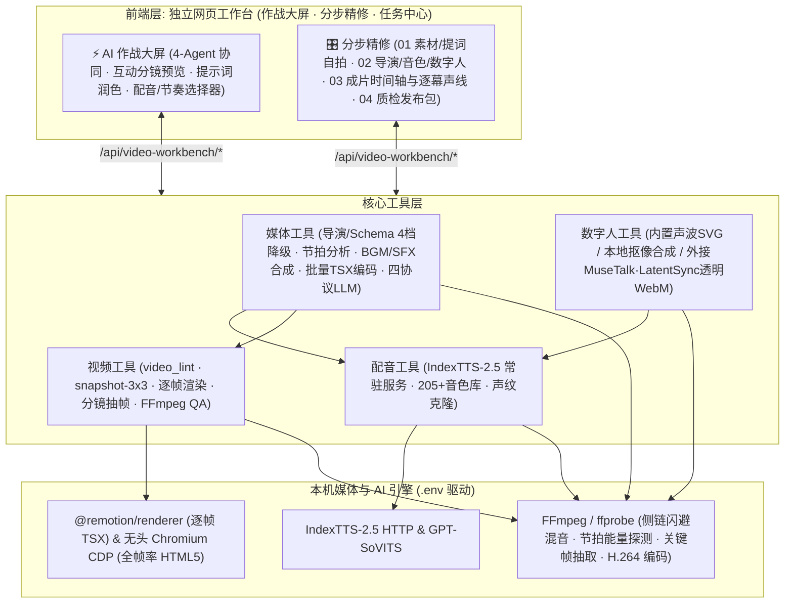

# 🎬 AI 视频工作台（独立版）

> **双引擎（Remotion 4.x + Three.js 3D & HTML5 + Three.js）多智能体 AI 视频全链路工作台**  
> **无需任何宿主软件，双击即可在浏览器使用：素材导入、AI 脚本与提示词润色、BGM 踩点、多引擎配音与声音克隆、自由编码 3D、全帧率 MP4 导出。**

[](./LICENSE)
[](#)
[](#)
[](#)

> 💡 **完全独立运行**：不依赖任何 AI 客户端或宿主程序，数据全部保存在本地，前端依赖已内置，断网也能打开（AI 润色功能需自行填写 API Key）。

---

## 📖 目录 / Table of Contents
- [✨ 一、核心特性 (Features)](#-一核心特性-features)
- [💻 二、电脑配置要求与低配保护 (Hardware & Low-Spec Guard)](#-二电脑配置要求与低配保护-hardware--low-spec-guard)
- [🏗️ 三、系统架构 (Architecture)](#️-三系统架构-architecture)
- [🚀 四、快速开始 (Quick Start)](#-四快速开始-quick-start)
- [🎯 五、工作台使用指南](#-五工作台使用指南)
- [🎙️ 六、多引擎配音与声音克隆指南](#️-六多引擎配音与声音克隆指南)
- [🤖 七、数字人叠加引擎](#-七数字人叠加引擎)
- [🔧 八、常见问题排查 (Troubleshooting)](#-八常见问题排查-troubleshooting)
- [📬 联系与致谢](#-联系与致谢)

---

## ✨ 一、核心特性 (Features)

1. **⚡ 4-Agent AI 作战大屏 + 分步精修工作台 + 实时任务监控**
   - **策划导演 Agent → 素材剪辑 Agent → 配音混音 Agent → 动效质检 & MP4 导出 Agent** 全程可视化接力运行，支持随时暂停、恢复、强停子进程与断点单步重试。

2. **🧠 通用四协议大模型接入 + ✨ AI 一键润色提示词**
   - 支持自定义接入 **OpenAI `/v1/chat/completions`**、**Anthropic `/v1/messages`**、**OpenAI `/v1/responses`** 与 **Google Gemini `/v1beta/models`** 四种接口协议，在网页的 AI 配置弹窗里填写 API Key 即可。
   - **第 2 步「✨ AI 一键润色提示词」**：只需写一句大白话需求，AI 会结合已上传的图片/视频/BGM 与笔记内容输出结构化方案（自动隔离 **观众可见标题/内容要点 (`displayTitle`/`contentOutline`)** 与 **AI 专用导演备注 (`directorNotes`)**），杜绝制作指令泄露到视频台词或屏幕画面；同时支持**全品类无限自由体裁路由**（内置 11 种常见题材参考起点 + 任意自创 `genreLabel` 全链路透传 + `freeform-stage` 零固定版式限制）与 **「↩ 恢复原句」**。
   - **纯正中文字幕与发音引擎 (`subtitle-engine`)**：严格分离后台语音朗读文本 (`ttsText`) 与屏幕显示字幕 (`subtitleText`)，画面字幕自动保留自然阿拉伯数字并剥离孤立引号，结合语义断句避免拆散词组或标点落单。

3. **🥁 音乐节拍踩点引擎 & 三种配音节奏模式 (`tts` / `tts-beat-sync` / `subtitle-mv`)**
   - 上传个人 BGM 后自动调用 FFmpeg 波形能量包络探测 **真实 BPM、首拍相位与高潮突降点 (Drops)**。
   - 前端提供明确选择器自由切换：
     - `🗣️ AI 真人配音`：逐幕调用本地 `IndexTTS-2.5` 合成人声旁白 + AI 声学修音 + 自动闪避混音；
     - `⚡ AI 配音+踩拍切镜`：保留真人旁白并让分镜切入贴合音乐节拍；
     - `🔥 纯音乐卡点 (免 TTS)`：跳过语音合成，按 `0.5` / `1` / `2` / `4` 拍自动对准重拍与高潮切镜，输出高燃纯动画 MV 与卡点音效（**无需任何大模型，开箱即用**）。
   - **依题材自适应节奏 (`auto` / `calm` / `balanced` / `dynamic`)**：品牌故事温情短片自动保持 `4~7s/镜` 从容留白，产品功能/教程保持 `3~5s/镜` 清晰解说，历史卡点 MV 才启用高速半拍闪烁切镜。

4. **🪐 Opus 级全开放自由编码 (`Freeform Three.js 3D` + 动态 `SVG` + `HUD` 遥测 + 节拍弹簧物理) + 内置保底预设**
   - **真实交互式教程镜头与像素级坐标锚点**：支持高清晰亮色 UI 教程拍摄模式（`windowTheme: "light"`、`1.8x~2.4x` 局部特写推镜 `<FocusShot>`、`(0,0)` 尖端对齐光标与点击涟漪 `<InteractiveCursor>`、`clipPath` 平滑抽屉展开 `<UiDrawerSlide>` 及逐字打字 `<UiTypingOverlay>`）。
   - **真正无预设束缚的 AI 自由造景 (`<FreeformThreeStage />` + 动态 `<svg>`)**：把原生 **`THREE.*`** 几何与相机接口、动态 **`<svg>`** 曲线工具与 HTML5 3D 透视投影开放给大模型主程，AI 可针对任意题材从零自由编写 3D 旋转地球、3D 芯片爆炸拆解、K线雷达图、思维导图或公式推演；内置 6 大 3D 舞台、5 种动态 SVG 拓扑与全息 HUD 代码面板既可作原子积木混搭，也作离线/容错保底。
   - **支柱 ① · 原生 `three` + `@remotion/three`**：内置 6 大帧级确定性 Three.js 3D 空间舞台预设，逐帧随音乐重拍脉冲与相机推拉同步响应。
   - **支柱 ② · 动态 SVG 系统架构拓扑图**：内置 5 种可编程架构拓扑，包含弹簧逐级弹出的架构节点卡与沿路径高速穿梭的数据包光子脉冲。
   - **支柱 ③ · 全息 HUD 遥测数据与实时代码流面板**：左侧实时滚动语法高亮的 TSX / Agent 执行代码流，右侧配备 SVG 环形进度仪表盘、数字滚轮与遥测波形图，四周叠加广播级时间码与重拍频谱仪。
   - **支柱 ④ · 节拍同步弹簧物理引擎**：将 Remotion `spring()` 阻尼刚度物理模型、`interpolate()` 确定性插值与音乐 `beats[]` 重拍冲击波深度耦合，赋予每个镜头真实的欠阻尼回弹与三维透视倾角。
   - **AI 作战大屏一站式发车控制台**：无需跳转即可自由切换渲染引擎（**`⚛️ Remotion + Three.js 3D`** / **`🌐 HTML5 + Three.js`**）、视效模式、**画质与帧率**（`1080p`/`2K`/`4K` · `30fps`/`60fps`）、背景配乐、主讲音色/克隆与数字人口播，所有参数实时同步落盘。

5. **🎙️ 多引擎灵活配音**（`IndexTTS-2.5` / `IndexTTS-2` · `GPT-SoVITS` · `Windows 系统原生纯CPU` · 自定义模型）
   - **不被单一模型绑定**：内置「多引擎配音中心」，可一键切换 **`IndexTTS-2.5`**（8GB+ 高保真情感克隆）、**`IndexTTS-2`**、**`GPT-SoVITS`**（4GB+ 显存轻量快速），以及面向**零独显低配电脑**的 **`Windows 系统原生中文语音 (0GB 显存免下载开箱即用)`**。
   - **支持自由添加/导入其他配音模型**：内置 OpenAI `/v1/audio/speech` 协议（Fish Speech、Kokoro 82M、OneAPI/SiliconFlow）、通用 HTTP JSON/GET（CosyVoice、ChatTTS、Sherpa-ONNX）以及零显卡纯 CPU 本地命令行（如 `edge-tts`）模板，支持 JSON 导入导出分享与一键试听测试。
   - 内置 205+ 音色标签库、浏览器录音降噪克隆与 `ffprobe` 实测帧数精确回填。

6. **🛡️ 实时硬件体检 & 低配电脑保护机制（8GB 内存 / 无独显亦可用）**
   - 工作台顶部右上角提供「💻 算力体检 / 🛡 低配保护」实时面板，进入工作台即可直观查看本机 CPU、空闲/总内存、GPU 显存与磁盘空间是否达标。
   - 当检测到低配硬件或空闲内存不足（`< 3.6 GB`）时，自动进入低配保护模式（`auto` / `safe` / `performance`），从并发进程数、浏览器缓存、粒子分辨率与 FFmpeg 编码线程全链路防爆内存、防卡死。

7. **开源商用合规 & 零硬编码敏感路径**
   - 内置商用免费开源 OFL 字体族（`Noto Sans SC`、`Source Han Serif SC Heavy`、`JetBrains Mono`），`video_lint` 自动拦截未授权商用系统字体。
   - 全部本机路径与接口密钥均由未追踪的 `.env` 驱动，仓库内零硬编码私人路径与密钥。

---

## 💻 二、电脑配置要求与低配保护 (Hardware & Low-Spec Guard)

> **常见问题澄清：为什么有些 AI 会提示"电脑配置太低无法运行"？**  
> 只有在运行**本地 `IndexTTS-2.5` 大模型声音克隆**或 **2K/4K 60fps 高并发渲染**时才需要 8GB+ 独立显存；而**核心双引擎视频渲染并不强制独立显卡**！配合内置的「低配电脑保护模式」与「Windows 原生纯 CPU / Edge-TTS / 纯音乐卡点配音」，**8GB 内存的普通办公笔记本也能稳定出片。**

| 档位说明 | CPU 处理器 | 系统内存 (RAM) | 显卡 / 显存要求 | 磁盘可用空间 | 适用工作流与建议规格 |
| :--- | :--- | :--- | :--- | :--- | :--- |
| **🟢 最低可运行配置**<br>*(开启低配保护模式)* | **4 核 4 线程** 及以上 | **8 GB**<br>*(渲染时空闲 ≥ 2.5 GB)* | **核显 / 无独显均可**<br>*(2D 安全投影，零 WebGL 崩溃)* | **≥ 3 GB** | • 分辨率：**720p · 30fps**（单并发保护）<br>• 配音：**Windows 原生语音 (0显存)** / **Edge-TTS** / **纯音乐卡点 (免 TTS)** / 云端 API |
| **🟡 流畅推荐配置** | **8 核** 及以上<br>*(i5 / Ryzen 5+)* | **16 GB**<br>*(空闲 ≥ 5.5 GB)* | **NVIDIA 6GB–8GB+ 显存**<br>*(可流畅本地跑 TTS + 渲染)* | **≥ 10 GB** | • 分辨率：**1080p · 30/60fps**<br>• 配音：本地 **GPT-SoVITS (4GB+)** 或 **IndexTTS-2.5** + 全功能 AI 编程 |
| **🔵 4K 旗舰配置** | **12–16 核** 及以上 | **32 GB+** | **NVIDIA RTX 8GB–16GB+** | **≥ 20 GB SSD** | • 分辨率：**2K / 4K · 60fps** 多并发极速渲染 + 本地 IndexTTS-2.5 满血情绪控制 |

### 🛡️ 内置五重「低配电脑保护机制」会自动做什么？
在工作台右上角点开「💻 配置 / 🛡 低配保护」（支持 `智能自适应 auto` / `强制低配保护 safe` / `全速性能 performance` 三档切换），激活保护后系统自动执行：
1. **浏览器并发与内存限流**：渲染浏览器强制限为单标签并发 + 媒体缓存从 `512MB` 降至 `128MB`，避免撑爆 8GB 内存。
2. **CPU 温和编码限核**：FFmpeg 编码线程自动限制在 `2–4` 核并切为 `veryfast` 预设，避免 100% 满载导致卡顿或系统无响应；延长单帧渲染超时阈值至 `180s`。
3. **画质与帧率智能护航**：在低配/强保护档自动将 `2K/4K` 或 `60fps` 护航降档为流畅 `720p/1080p 30fps`。
4. **3D 画布轻量减载**：3D 舞台自动以 `0.72x` 内部画布尺寸渲染并缩减 `45%` 实时粒子数。
5. **零显卡配音兜底推荐**：检测到无 `4GB+` NVIDIA 显存时，自动引导或默认启用零显卡方案，绝不把无独显用户拦在门外。

---

## 🏗️ 三、系统架构 (Architecture)



---

## 🚀 四、快速开始 (Quick Start)

### 前置依赖（按需准备）
- **必装**：
  - [Node.js](https://nodejs.org/) `>= 22.0.0`
  - `FFmpeg` 与 `ffprobe`（已加入系统 `PATH` 即可，或在 `.env` 中指定绝对路径）
  - Windows 系统已安装 **Microsoft Edge** 或 Chrome（用于 HTML5 无头 Chromium 逐帧渲染）
- **可选（按需开启对应引擎）**：
  - **本地真人配音 / 克隆**：本机准备 [IndexTTS-2.5](https://github.com/index-tts/index-tts) 仓库目录与可运行其推理的 Python 环境。如暂未部署，仍可使用「纯音乐卡点 (免 TTS)」或 Windows 系统自带语音。
  - **Remotion 引擎**：依赖已随包安装，无需额外配置模板工程。

### 启动（三种方式，任选其一）

**方式 A：双击启动（最省事，Windows）**
- 双击项目根目录的 **`启动视频工作台.cmd`**，脚本会自动检查依赖、启动服务并打开浏览器。

**方式 B：命令行启动（跨平台）**
```bash
cd 项目目录
npm install          # 首次运行安装依赖
node start.mjs       # 启动并自动打开浏览器
node start.mjs --no-open   # 只启动服务，不打开浏览器
```

**方式 C：直接调用核心脚本**
```bash
node scripts/dsh-runner.mjs video --keep-alive
```

默认监听 `http://127.0.0.1:4399`，可用环境变量 `VIDEO_PORT` 修改端口。

### 首次使用配置 AI（可选）
纯音乐卡点、剪辑、渲染、系统配音等功能不依赖大模型，可直接用。若要使用 **AI 一键润色提示词 / AI 自由编码**：
1. 打开工作台右上角的 AI / 模型配置弹窗；
2. 选择「🔑 自定义接入」，按你手上的 API 选择 OpenAI / Anthropic / Responses / Gemini 协议之一；
3. 填入 `Base URL`、`API Key` 与模型名，保存即可。

> 🔒 所有工程数据、配置与素材都保存在项目目录内（`.env`、`projects/`），不会写入用户主目录或其它软件的配置区。

---

## 🎯 五、工作台使用指南

1. **创建或切换视频工程**：点击左上角工程下拉胶囊，新建空工程或切换现有工程。
2. **Card 1 · 导入素材 / 极速备料**：拖拽图片、视频片段、背景音乐 (`BGM`)、文本笔记 (`txt`/`md`)，或点击「一键加载演示素材」/「打开提词器自拍」。
3. **Card 2 · 编写或 AI 润色指令 + 选定节奏与配音方式**：
   - 输入一句简单想法，点击右上角「✨ AI 一键润色提示词」自动生成专业导演指令（不满意可点「↩ 恢复原句」）；
   - 按需选择画面比例、视觉基调、节奏适配方案（`AI智能适配` / `舒缓` / `稳健` / `高燃`）、AI 辅助角标开关与四角位置，以及配音与卡点节奏模式（`AI真人配音` / `配音+踩拍` / `纯音乐卡点免TTS`）。
4. **Card 3 · 发车检查并启动 4-Agent 全自动出片**：等待 4 张 Agent 卡片接力跑完，中心自动切出高清 MP4 播放器或跳转第 3 步「监看台与改片」逐幕精修文案、替换单幕配音音色或用自然语言让 AI 重写单幕特效。

---

## 🎙️ 六、多引擎配音与声音克隆指南

- **Windows 原生语音（零配置兜底）**：未部署本地模型时自动使用系统自带中文语音，无需显卡与下载，开箱即用。
- **IndexTTS-2.5 常驻服务自动拉起**：选中 `IndexTTS-2.5` 并调用配音或一键出片时，会自动探测服务端点（默认 `http://127.0.0.1:9880`），若尚未启动则使用配置好的 Python 环境自动拉起常驻服务。
- **GPT-SoVITS（低显存电脑首选）**：在顶栏「配音: ...」或第 2 步点击「GPT-SoVITS (低显存)」即可切换；支持连接本机已启动的 `api_v2.py` / `api.py`（默认 `http://127.0.0.1:9881`，可在面板中自由修改端口）。
- **自定义 / 导入其他配音模型（含纯 CPU 免显卡方案）**：在「多引擎配音中心 → ➕ 添加自定义配音模型」中，可载入 `Edge-TTS (0GB 纯 CPU)`、`Fish Speech / OpenAI /v1/audio/speech`、`Kokoro 82M`、`CosyVoice / ChatTTS HTTP` 等模板，或自定义 JSON 导入与一键测试试听。
- **205+ 音色库 & 一键声纹克隆**：打开「选音色 / 克隆我的声音」弹窗，支持试听预置/本地扫描音色，也支持上传清晰干声 `.wav` / `.mp3` 或麦克风录音一键降噪标准化入库。

---

## 🤖 七、数字人叠加引擎

工作台清楚区分了两种模式（均为带透明 Alpha 通道 `yuva420p` `.webm` 输出）：
1. **免外部 GPU 算力的内置模式（开箱即用）**
   - **纯 AI 主播形象 (`ai-human`)**：读取逐句合成语音的振幅包络 (RMS)，驱动内置矢量人物实时口型张合与眨眼动画，经无头 Chromium 录制成透明 `.webm` 叠加。
   - **克隆真人底板 (`cloned-human`)**：克隆本人声音，并用 FFmpeg 对上传的写真图/出镜视频做圆角画中画或绿幕色键 (`chromakey`) 抠像叠加。
2. **外接真实神经网络对口型服务（可选扩展）**
   - 在 Step 2 数字人卡片右上角点「⚙ 引擎配置」（或编辑 `.env` 中的 `AVATAR_PROVIDER` / `AVATAR_ENDPOINT` / `AVATAR_API_KEY`），填入你部署的 **MuseTalk** 或 **LatentSync** 推理接口，即可生成真实唇形驱动的透明 `.webm`。

---

## 🔧 八、常见问题排查 (Troubleshooting)

1. **点击「开启摄像头与麦克风」提示 `Permission denied` 怎么办？**
   - 原因通常为浏览器站点未放行相机权限，或 Windows「设置 → 隐私和安全性 → 相机/麦克风 → 允许桌面应用访问」被关闭。
   - 解决：提词自拍弹窗已内置零阻塞退路——会先尝试降级为仅麦克风录音；若均被拦截，可直接点「🌐 在系统浏览器中打开自拍」正常授权录制，或点「📁 直接上传本机已录视频/音频入库」。

2. **单独打开 `http://127.0.0.1:4399` 遇到黑屏或端口被占用怎么办？**
   - 原因通常为后台残留了旧的 `dsh-runner.mjs` 进程监听在 `4399`，导致浏览器拉到新旧不匹配脚本。
   - 解决：关闭旧窗口或设置 `VIDEO_PORT` 换端口后重启；最新版内置了启动诊断卡与多 CDN 容错，不会再黑屏。

3. **如何制作"纯音乐卡点动画（完全跳过 AI 配音）"？**
   - 在 AI 作战大屏第 2 张卡片最下方「🥁 配音与卡点节奏模式」直接切换为「🔥 纯音乐卡点 (免 TTS)」即可；上传个人 BGM 后会自动对齐重拍与高潮段落。此模式完全离线、不需要任何大模型。

4. **AI 润色报错"未配置模型"怎么办？**
   - 在网页的 AI 配置弹窗里填写你的 API Key（见「快速开始 → 首次使用配置 AI」）。若只用剪辑/踩点/配音/导出，无需配置。

---

## 📬 联系与致谢

使用过程中遇到配置问题、Bug 反馈或功能建议，欢迎通过本仓库的 Issue 反馈：

- **GitHub Issue**：https://github.com/H1088880/video-workbench-standalone/issues
- **开源协议**：[MIT License](./LICENSE)
- **原创作者**：**Merziller**（[原项目 dsh-video-workbench](https://github.com/Merziller/dsh-video-workbench)）
- **致谢**：本独立版基于原作者 Merziller 的开源项目改造，保留原作者署名，并遵循 MIT 授权。

---

## 🌐 English

**AI Video Workbench (Standalone Edition)** is a dual-engine (Remotion 4.x TSX + HTML5/Canvas with Three.js) multi-agent AI video studio that runs entirely standalone in your browser — no host application required. It orchestrates a 4-Agent pipeline (`Director → Asset Editor → TTS/SFX/BGM Mixer → Motion Coder & QA Renderer`) with adaptive genre pacing, FFT/RMS BGM beat-sync (`tts`, `tts-beat-sync`, `subtitle-mv`), multi-engine TTS (`IndexTTS-2.5`, `GPT-SoVITS`, zero-GPU Windows SAPI, plus importable OpenAI/HTTP/CPU-CLI models) with voice cloning, real-time **Hardware Preflight & Low-Spec Protection Mode** (8GB RAM + iGPU/CPU-only supported), commercial-safe OFL typography, and model-agnostic 4-protocol LLM authoring.

**Quick start**: double-click `启动视频工作台.cmd` (Windows), or run `npm install && node start.mjs`, then open `http://127.0.0.1:4399`. Requires Node.js 22+ and FFmpeg on PATH. Released under the [MIT License](./LICENSE).

**Original author**: **Merziller** ([original project](https://github.com/Merziller/dsh-video-workbench)). This standalone edition is adapted from the original open-source work, with the author credit preserved.
